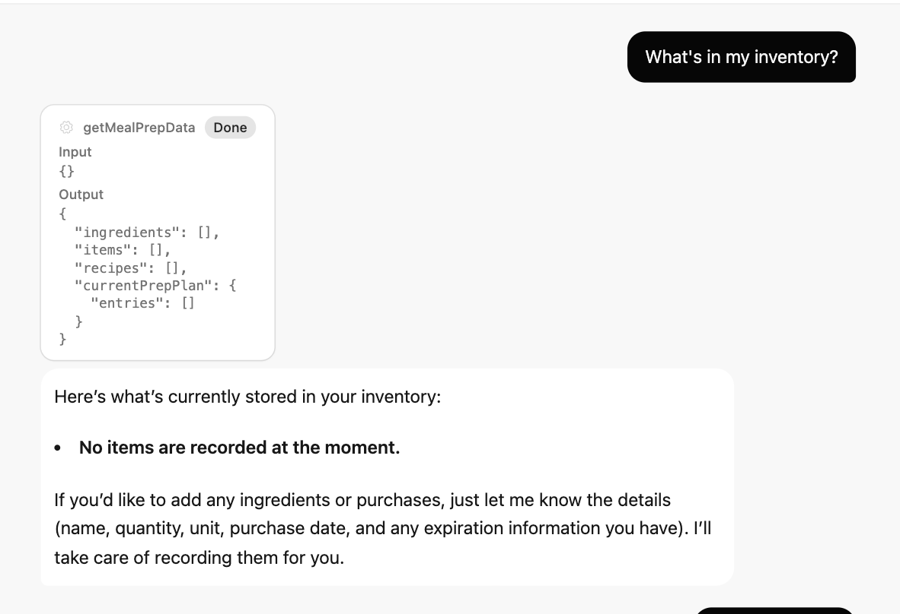
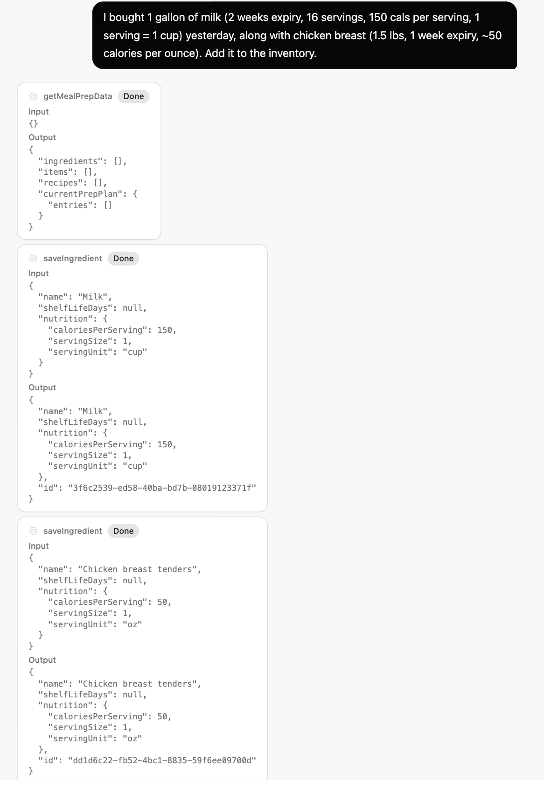
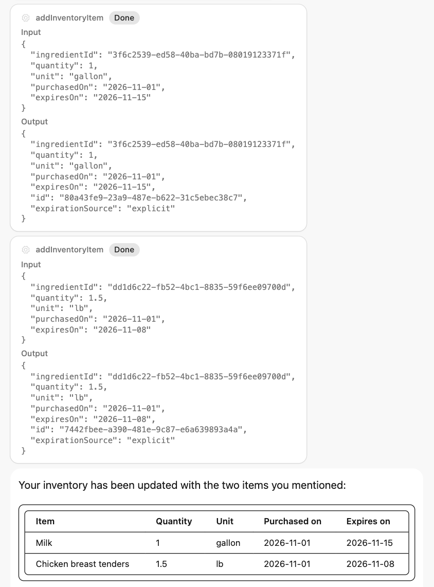
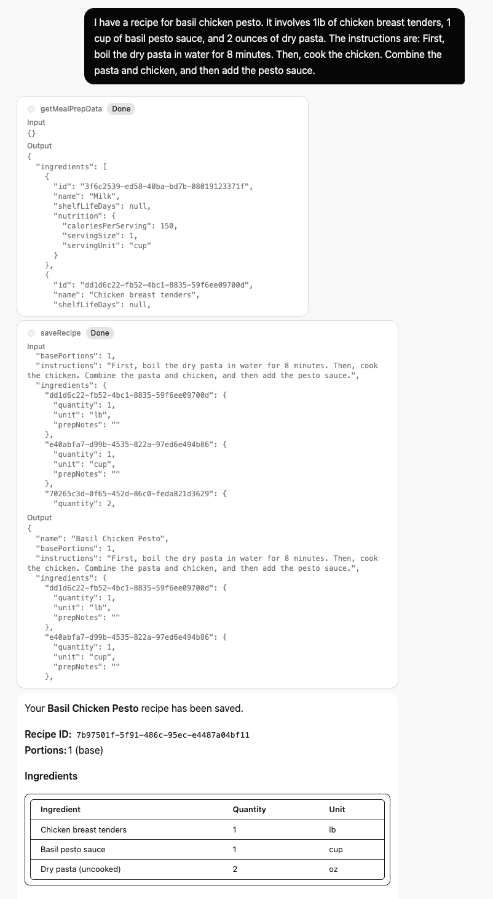
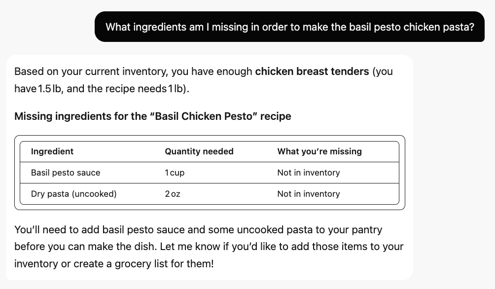

## Introduction

Hey there! :wave:
I'm Mayank Daruka, this is an initial prototype of a meal-prep assistant I've built using Cloudflare Agents, Workers AI, React and Durable Object SQLite.
I recently moved to Austin from Seattle, and I've started to get back into meal-prepping again. I found myself struggling to keep track of ingredients, inventory, and recipes, so I thought it would be a good opportunity to build a tool that helps me manage all of that efficiently.

Note: AI was used to assist in building this assistant. My prompts to the AI involved providing detailed descriptions of the below features and continuously re-iterating over generated code to refine and improve the implementation.

## Application Features

Here's a quick overview of the assistant's capabilities:

- It remembers every ingredient, along with their shelf-life details, nutritional facts if specified by the user
- It keeps track of individual inventory items (and correlates them to ingredients) with original size/quantities, expiration dates etc.
- It stores exact recipes, this includes a mapping of each ingredient to the exact quantity needed and the way it should be prepared (ex. for garlic - does it need to be minced, sliced, or crushed)
- It maintains a current meal prep plan with desired portions based on user input
- It calculates the delta of required ingredients versus what is currently available in inventory, and makes a grocery list for missing items

## Usage

1. Start a conversation with the meal-prep assistant.

   

2. Save ingredients and their details.

   

3. Add the items you have to your inventory.

   

4. Create a recipe with ingredient quantities and preparation notes.

   

5. Generate a grocery list for your prep plan.

   

## What's Next?

There is plenty of room for improvement here:

- Real-time querying of recipe links and automatic parsing of ingredients, portions, etc.
- Recipe / ingredient image integration
- Improved meal-prep plan visualization for tracking
- Usage of nutritional information to plan meals based on dietary needs, calorie limits
- Supporting additional health goals by tracking protein, fiber, etc.
- Standardized set of measurement units and hardcoded conversions between them to reduce LLM-related ambiguity in recipe calculations

## Run Locally

```sh
npm install
npm run start
```

Workers AI runs remotely through your Cloudflare account, even during local development. The configured model is `@cf/openai/gpt-oss-120b` with low reasoning effort. It accepts text and supports tool calling.

## Verify Locally

```sh
npm run lint
npx tsc --noEmit
node --experimental-strip-types --test src/meal-prep.test.ts src/meal-store.test.ts
```

The tests require Node with `node:sqlite` support. `npm run check` also checks repository-wide formatting.

## Deploy to Cloudflare

```sh
npm run deploy
```

Deployment uses the Cloudflare account authenticated with Wrangler. Inference remains subject to that account's Workers AI model access and usage limits.
